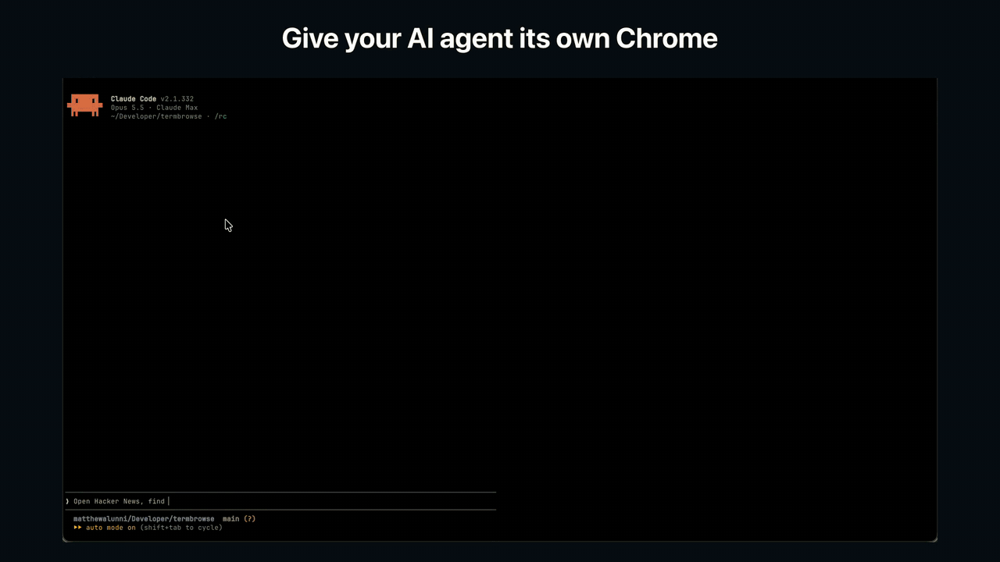

# termbrowse

termbrowse draws a live Chrome tab inside your terminal with the Kitty graphics protocol. It also gives each AI coding agent its own Chrome for Testing through an MCP server, so you can watch any agent's browser in a pane next to it. It never touches your everyday Google Chrome or its profile. It downloads and uses Chrome for Testing, keeps one profile per agent, and lets you sign in once with `termbrowse login` so new agent profiles start signed in.



The viewer is interactive: click, scroll, type and paste into the page from the terminal (see [Using the page](#using-the-page)). On an agent's browser, the first thing you do takes control from the agent until you hand it back.

## Install

termbrowse runs on macOS and Linux and needs Node 22 or newer. Pick one:

```sh
npm install -g termbrowse                      # with Node already installed
brew install matthewalunni/tap/termbrowse      # Homebrew (macOS or Linux); brings its own Node
```

Then check the setup:

```sh
termbrowse doctor
```

To run without installing, use `npx termbrowse <command>` (for example `npx termbrowse doctor`). Claude Code users can also skip this step: the [plugin](#claude-code-plugin) runs termbrowse through `npx` when it isn't installed.

From a checkout (for development):

```sh
git clone git@github.com:matthewalunni/termbrowse.git
cd termbrowse
npm ci
npm link          # puts `termbrowse` on your PATH
```

Chrome for Testing downloads to `~/.cache/termbrowse` the first time something needs it (about 150 MB).

## Three ways to use it

### 1. `termbrowse <url>`: a browser in this terminal

```sh
termbrowse example.com
termbrowse localhost:3000        # localhost and 127.0.0.1 get http://
```

This starts a Chrome for Testing of its own and draws the page in the terminal. In a terminal that can't draw Kitty graphics it says so and exits 2 before starting any Chrome. The viewer has vim-style keys (see [Using the page](#using-the-page)): type `:q` and Enter to quit, or press Ctrl-C (except in Insert mode, where Ctrl-C goes to the page). Quitting closes that Chrome. The last row is a status line with the mode, the URL and the main keys, e.g. `NORMAL · <url> · f links · i insert · :q quit · ? help`, or `paused` (the pane is too small) or `disconnected` (Chrome went away). When a new tab opens (a popup, or a page an agent opens with `new_page`), the viewer switches to it, and when that tab closes it goes back to the tab it was showing before.

Each run uses a fresh copy of the starter profile (see `termbrowse login`), and that copy is deleted when you quit. Signing in during a `termbrowse <url>` session lasts only for that session. You can run several at once.

### 2. `termbrowse view`: watch a Chrome that is already running

```sh
termbrowse view --agent t2p             # the Chrome of agent t2p (see `termbrowse agents`)
termbrowse view --port 9222             # any Chrome with a debugging port on 127.0.0.1
termbrowse view --agent t2p --tab docs  # the tab whose URL or title contains "docs"
```

`--tab` picks the first tab whose URL or title contains the text, ignoring case. If no tab matches, the viewer shows the first tab.

Quitting the viewer leaves that Chrome running. On an agent's browser, your first click, scroll, paste or key that changes the page takes control from the agent (see [Taking over from an agent](#taking-over-from-an-agent)). If the agent has no browser yet, `view --agent` says so and exits 1. An agent's Chrome only starts on its first browser action.

### 3. `termbrowse mcp`: one Chrome per agent

`termbrowse mcp` is an MCP server (stdio). It runs [chrome-devtools-mcp](https://github.com/ChromeDevTools/chrome-devtools-mcp) (pinned to 1.13.0) against a Chrome for Testing that belongs to one agent. That Chrome starts on the agent's first browser tool call, not when the MCP server starts. The agent's tool list is available immediately.

Which agent it is, in this order: `$TERMBROWSE_AGENT`, then `$HC_TERMINAL_ID` (Herdr's terminal id), then `pid-<parent pid>`. A new agent's profile is copied from the starter profile.

An agent named by `TERMBROWSE_AGENT` or `HC_TERMINAL_ID` keeps its own profile across MCP restarts and sessions, so its sign-ins and cookies stay (until it is unused for `prune_days`). A `pid-<parent pid>` profile belongs to that one agent process: once the process has exited, the next termbrowse command deletes it. Outside Herdr, set `TERMBROWSE_AGENT` in the MCP server's environment to keep an agent's profile from one session to the next, e.g. `"env": { "TERMBROWSE_AGENT": "reviewer" }` in `.mcp.json`.

Claude Code:

```sh
claude mcp add termbrowse -- termbrowse mcp
```

or in `.mcp.json`:

```json
{
  "mcpServers": {
    "termbrowse": { "command": "termbrowse", "args": ["mcp"] }
  }
}
```

Codex (`~/.codex/config.toml`). Naming the server `chrome-devtools` replaces an existing chrome-devtools-mcp entry of that name, so the agent keeps the tool names it knows and gets only one browser server:

```toml
[mcp_servers.chrome-devtools]
command = "termbrowse"
args = ["mcp"]
```

For Claude Code, the plugin below sets this up for you.

Arguments after `--` go to chrome-devtools-mcp: `termbrowse mcp -- --some-flag`.

When the agent exits, its Chrome closes. If the MCP process is killed without cleaning up (SIGKILL, a crash), its Chrome is closed by the next termbrowse command that reads the list of browsers (`agents`, `stop`, `view --agent`, `mcp`, `termbrowse <url>`).

## Claude Code plugin

This repository is also a Claude Code plugin. The plugin doesn't contain a copy of termbrowse: its MCP server runs the `termbrowse` command from your PATH, or `npx -y termbrowse` when it isn't there (that needs Node 22 or newer, and the first start downloads the package). Installing the CLI (see [Install](#install)) is still worth it: you need it for `termbrowse view`, and the MCP server starts faster. `termbrowse doctor` reports `termbrowse on PATH: ok` when the plugin will use it.

Then add this repository as a marketplace and install the plugin:

```sh
claude plugin marketplace add matthewalunni/termbrowse   # or the path to your checkout
claude plugin install termbrowse@termbrowse
```

The plugin provides:

- an MCP server named `chrome-devtools` that runs `termbrowse mcp`, so each agent gets its own Chrome for Testing. Its tools are called `mcp__plugin_termbrowse_chrome-devtools__<tool>`.
- the skills from Google's chrome-devtools-mcp plugin (`chrome-devtools`, `a11y-debugging`, `cookie-debugging`, `debug-optimize-lcp`, `memory-leak-debugging`, `troubleshooting`), copied unchanged from version 1.11.0. Its `chrome-devtools-cli` skill is left out because it drives Google's separate `chrome-devtools` CLI, not termbrowse.
- `watch-browser`, a skill that has the agent tell you the `termbrowse view --agent <id>` command for its browser and, in Herdr, offer to open it in a pane beside its own. It also has the agent ask you to take over when it is stuck on a login, 2FA or CAPTCHA, and carry on once you hand the browser back.

If you have Google's `chrome-devtools-mcp` plugin installed, disable it (`claude plugin disable chrome-devtools-mcp@claude-plugins-official`). Otherwise each agent gets two browser servers with the same tools: Google's, which drives a Chrome of its own that termbrowse can't show, and termbrowse's. You could switch off just its server in `/mcp`, but its skills would still load next to the copies in this plugin, so disabling the whole plugin is simpler.

The copied skills are © Google LLC under the Apache License 2.0; see [`skills/NOTICE`](skills/NOTICE) and [`skills/LICENSE-APACHE-2.0`](skills/LICENSE-APACHE-2.0). The plugin files (`.claude-plugin/`, `skills/`) aren't part of the npm package.

## Other commands

```sh
termbrowse agents [--json]          # live Chromes: AGENT  KIND  PORT  PID  URL
termbrowse stop --agent ID          # close one agent's Chrome
termbrowse stop --all               # close every Chrome termbrowse started
termbrowse login [url] [--reset]    # sign in once, for every new profile
termbrowse doctor                   # check Node, config, Chrome, display, libraries, PATH, terminal
termbrowse --version
```

`stop --agent` on an MCP agent closes its Chrome. The wrapper starts a new one on the agent's next browser tool call.

## `termbrowse login`

```sh
termbrowse login github.com
```

This opens a normal Chrome for Testing window (even when `headless = true`) on the starter profile. Sign in to the sites your agents need, then press Enter in the terminal or close the browser window.

termbrowse then prints `Saving your sign-ins…` and keeps Chrome running for 35 seconds before closing it. Chrome writes cookies to disk on a timer of about 30 seconds, not when it quits. In a test, a cookie set 3 seconds before closing never reached the disk. Ctrl-C during the wait asks once more, and a second Ctrl-C quits at once, which may lose recent sign-ins.

- New agent profiles and every `termbrowse <url>` run start from a copy of this profile. Agents that already have a profile keep their own sign-ins and don't pick up new ones. To give an existing agent the new sign-ins, delete its folder under `~/.local/state/termbrowse/profiles/`.
- `--reset` deletes the starter profile first.
- Login needs a display. On Linux without `DISPLAY` or `WAYLAND_DISPLAY` it exits 1. Sign in on a machine with a screen instead.
- On macOS, termbrowse starts every Chrome with a mock keychain (`--use-mock-keychain`), so it never prompts for Keychain access. Its saved logins live only in termbrowse's own profiles, not in your Keychain, and every termbrowse profile uses the same cookie key, so a profile copied from the starter still reads the starter's cookies. A starter profile signed in before termbrowse used the mock keychain may lose those sign-ins (its cookies were encrypted with the Keychain key): if so, run `termbrowse login --reset` and sign in again.

## Configuration

termbrowse reads `$TERMBROWSE_CONFIG` or, if that is unset, `$XDG_CONFIG_HOME/termbrowse/config.toml` (default `~/.config/termbrowse/config.toml`). The file is optional. These are all the keys, with their defaults:

```toml
[chrome]
channel = "stable"          # Chrome for Testing channel: stable, beta, dev, canary
headless = false            # forced true on Linux with no DISPLAY / WAYLAND_DISPLAY
background = true           # macOS: open agent and `termbrowse <url>` windows without taking focus
window_size = "1280x800"    # agent and standalone window size, "WIDTHxHEIGHT"
extra_args = []             # extra Chrome flags, e.g. ["--lang=en-US"]

[agents]
prune_days = 7              # delete agent profiles unused for this many days

[hooks]
on_launch = ""              # shell command run after a termbrowse Chrome starts

[view]
fill_pane = true             # pages opened with `termbrowse <url>` (and `view --port` on such a browser) fill the pane
fill_pane_for_agents = false # agent browsers fill the pane too (`view --agent`, `view --port` on an agent's port)
interactive = true           # false: watch only, like --watch (no input reaches the page)

[control]                    # taking over an agent's browser, durations like "90s", "5m", "2h"
idle_return = "5m"           # hand the browser back after this long without input (more than 0, at most 24 days)
max_wait = "10m"             # the longest an agent's tool call waits while you hold control
```

On macOS, agent windows and `termbrowse <url>` windows open in the background, so they don't steal focus from your terminal (or pull a window manager that follows focus onto their workspace). Set `background = false` to have them come to the front as they open. `termbrowse login` always comes to the front, since you type into it.

`on_launch` runs with `sh -c` once the new Chrome has a page. Its environment has these variables:

- `TERMBROWSE_PID`: Chrome's pid.
- `TERMBROWSE_PORT`: Chrome's debugging port.
- `TERMBROWSE_AGENT`: the agent id. It is empty for `termbrowse <url>`.
- `TERMBROWSE_KIND`: `agent` or `standalone`.
- `TERMBROWSE_HEADLESS`: `1` if this Chrome is headless (no window), else `0`.
- `TERMBROWSE_BUNDLE_ID`: `com.google.chrome.for.testing` on macOS, empty on Linux.

The hook runs in the background, so it doesn't delay the agent or the viewer. A hook that fails is logged to `~/.local/state/termbrowse/logs/hook.log`, and it never stops termbrowse. A hook that runs longer than 10 seconds is killed along with its children, so start longer work with `nohup` or `setsid`. Window-manager recipes (AeroSpace, yabai, Hyprland) are in [docs/hooks.md](docs/hooks.md).

Other environment variables:

| Variable | Effect |
| --- | --- |
| `TERMBROWSE_AGENT` | agent id for `termbrowse mcp` (overrides `HC_TERMINAL_ID`) |
| `TERMBROWSE_ASSUME_KITTY=1` | treat the terminal as able to draw Kitty graphics without asking it |
| `TERMBROWSE_CONFIG` | path of the config file |
| `XDG_STATE_HOME` | state: registry, profiles, logs (default `~/.local/state/termbrowse`) |
| `XDG_CACHE_HOME` | Chrome for Testing downloads (default `~/.cache/termbrowse`) |

## Using the page

The viewer works like Vimium: in **Normal** mode letters are commands, and in **Insert** mode keys go to the page. Only the image area takes mouse input: the status row and any empty margin around the image do nothing.

- **Mouse**: click (left, middle, right), double and triple click, drag and scroll wheel all reach the page, in either mode. Clicking a text field enters Insert; clicking anything else returns to Normal. Moving the pointer alone never takes control of an agent's browser; hover is forwarded to the page while you hold control (on a browser started by `termbrowse <url>`, always).
- **Keys**: in Insert, letters, digits, punctuation, Enter, Tab, Backspace, arrows, Home, End, PageUp, PageDown, Insert, Delete and F1 to F12, with Ctrl, Alt and Shift, go to the page; only `Esc` stays with the viewer. In Normal, arrows, PageUp, PageDown, Home, End, Space, Enter, Tab and keys with Ctrl, Alt or Cmd also go to the page. Terminals without the Kitty keyboard protocol work for plain typing, Enter, Backspace and arrows; modified keys are more reliable in Kitty, Ghostty and Herdr. Accented letters, emoji and other non-ASCII text are inserted as text.
- **Paste**: bracketed paste goes into the focused field in one piece (in Normal too).

### Modes

| Mode | Status row | You get there with | Keys |
| --- | --- | --- | --- |
| Normal | `NORMAL · …` | start; `Esc` from Insert | the commands below |
| Insert | `INSERT · … Esc normal` | `i`, `gi`, clicking or picking a text field | go to the page; `Esc` back to Normal |
| `:` line | `:<typed>█ · Esc cancel` | `:` | a command, then Enter; `Esc` or Backspace on an empty line cancels |
| find | `/<typed>█ · Esc cancel` | `/` | text, then Enter: `match <i>/<n>` or `no matches`; an empty line repeats the last find; `Esc` cancels |
| hints | `f: type a label · Esc cancel` | `f`, `F` | a label clicks its link or field; `Esc` cancels |
| help | `help · any key to close` | `?`, `:help` | any key closes it |

### Normal keys

The same table as the help screen (`?`). A two-key sequence (`gg`, `gi`, `gt`, `gT`, `yy`) must be finished within 1 second; a key that doesn't finish it is handled on its own.

| Keys | Does |
| --- | --- |
| `:q` | quit (Ctrl-C too, in Normal) |
| `Esc` | Insert → Normal; in Normal, hand control back |
| `:done` | hand control back to the agent |
| `j` `k` / `h` `l` | scroll down / up / left / right (60 px) |
| `d` `u` | half a page down / up |
| `gg` `G` | top / bottom |
| `f` `F` | link hints: type a label to click it (`F`: in a new tab) |
| `gi` | focus the first text field (Insert) |
| `i` | Insert: keys go to the page |
| `/` `n` `N` | find; next / previous match |
| `H` `L` | back / forward |
| `r` | reload |
| `J` `gT` / `K` `gt` | previous / next tab |
| `t` `x` | new tab / close tab |
| `yy` | copy the URL (OSC 52) |
| `:o <url>` | open a URL |
| `:esc` | send Escape to the page |
| `?` | this help |

Other letters do nothing in Normal; they never reach the page. Link hints and find cover the top document only, not pages inside iframes.

### `:` commands

| Command | Does |
| --- | --- |
| `:q`, `:quit` | quit the viewer |
| `:done` | hand an agent's browser back to the agent |
| `:o <url>`, `:open <url>` | open a URL in this tab (`localhost` and `127.0.0.1` get `http://`, other bare addresses `https://`) |
| `:esc` | send the Escape key to the page (e.g. to close a page's dialog) |
| `:help` | the help screen |

An unknown command shows `not a command: <text>`.

### Esc, level by level

`Esc` never reaches the page (use `:esc` for that). Each press goes up one level:

1. On the `:` or `/` line, in hints, or partway through a sequence like `g`: cancels it, back to Normal.
2. In Insert: back to Normal (the field loses focus).
3. In Normal while you hold an agent's browser: hands control back.

So from typing in a field, `Esc` `Esc` hands the browser back.

### Who has control

On an agent's browser, these take control: a click, a scroll (wheel or keys), `f`/`F` (when pressed), `i`, typing in Insert, `gi`, `/`, `n`, `N`, `H`, `L`, `r`, `J`, `K`, `gT`, `gt`, `t`, `x`, `:o`, `:esc`, paste, and keys passed to the page. These never do: `?`, `:help`, `yy`, typing on the `:` line, `Esc`, `:done`, `:q` and Ctrl-C.

### Quitting

`:q` (or `:quit`) and Enter, or Ctrl-C in Normal, quit the viewer. Ctrl-C also quits from the `:` and `/` lines, from hints and from the help screen. In Insert, Ctrl-C goes to the page (to copy, or to stop a program in a web terminal): press `Esc` first. A signal (SIGINT, SIGTERM, SIGHUP, e.g. closing the pane) also quits. Quitting hands an agent's browser back.

Clicking a pane only to focus it doesn't click the page: in terminals that report focus (Kitty, Ghostty, WezTerm and others), a press within 150 ms of the pane gaining focus is dropped, and scrolling over a pane that doesn't have focus is ignored. Terminals that don't report focus behave as if always focused.

**Watch only**: `termbrowse <url> --watch` and `termbrowse view … --watch` draw the page without sending it any input, so they never take control of an agent's browser. They have no modes: `q` and Ctrl-C quit. Set `interactive = false` under `[view]` to make that the default.

**`[keys]` is retired.** The `Ctrl-]` prefix keys are gone. A config with `prefix`, `give_back` or `quit` under `[keys]` still loads; termbrowse prints `termbrowse: [keys] is no longer used (vim mode); see README` once on stderr and ignores them.

On macOS, editing shortcuts in the page (select all, deleting a word, copy and paste with the keyboard) may not work: Chrome on a Mac performs them as editing commands, not from the key alone, and termbrowse doesn't send those commands yet. Typing, Enter, Backspace and arrows work. Linux is not affected.

### Taking over from an agent

Control applies to agent browsers only (`view --agent ID`, or `view --port` on an agent's port). A browser started by `termbrowse <url>` is always yours and never has a hand-back. Run the viewer on the host where the agent runs: termbrowse tells an agent's browser from others by its own registry there. A `view --port` through an ssh tunnel from another machine acts as a standalone browser: your input reaches the page, but the agent's calls don't wait for you and there is no hand-back. Watching, Help and the `:` line never take control; the first click, scroll, paste or key that acts on the page does (see [Who has control](#who-has-control)). Then:

- The status row reads `NORMAL · you have control · Esc or :done hand back · <url>` (in Insert, `INSERT · you have control · Esc normal`). While the agent holds the browser, it reads `NORMAL · agent driving · <url> · f links · i insert · :q quit · ? help`. If the agent was in the middle of an action when you took control, the row says `agent was acting…` for about 2 seconds.
- The agent's browser tool calls wait: `termbrowse mcp` holds each call until you hand the browser back. Nothing is dropped, and calls that need no browser (the tool list, for example) still answer.
- You hand the browser back with `Esc` in Normal (from Insert, `Esc` `Esc`), with `:done`, by quitting the viewer (`:q`), or by leaving it idle for `idle_return` (default 5 minutes). If the viewer process dies, the agent notices within about a second.
- The agent's next browser tool result after you hand back carries an extra text item: `Note from termbrowse: the user took control of this browser for <duration> (<while you waited, <wait>|since your last action>). The page may have changed; it is now at <url>. Re-check the page (e.g. take a snapshot) before continuing.` The duration runs from your first input to when the agent got the browser back, and `<wait>` is how long that tool call was held. If control came back because you left it idle, the note says so after the first sentence: ` Their last input was <time> in; control came back automatically after <idle_return> with no input.` If the viewer died without handing back, it says ` Their viewer closed without handing back. Their last input was <time> in.` (When the last input came within the first second, the note says `in the first second` instead of `<time> in`.) If you changed tabs (`J`, `K`, `gt`, `gT`, `t`, `x`), it adds ` The user changed tabs; call list_pages and select_page before continuing.` The URL is the page the agent's browser is on when the note is written.
- If you keep control for longer than `max_wait` (default 10 minutes) while a call waits, that call fails with the MCP error `termbrowse: the user has control of the browser; try again later` (code -32000), and the agent can try again.
- When the agent closes its last page, its Chrome stays up on `about:blank` (Chrome keeps one tab open) until the agent's session ends or you run `termbrowse stop --agent ID`, so `termbrowse agents` still lists it. The viewer then reads `NORMAL · blank page · waiting for the agent` over a white pane.
- If termbrowse can't write the control file, the viewer says `couldn't take control: <reason>` and the agent isn't blocked. Your input still reaches the page.

Warning: the agent's tool call may time out on its own side before `max_wait`, because the call really is held. Raise your agent's MCP tool timeout, or lower `max_wait`:

- Claude Code: set `MCP_TOOL_TIMEOUT` (milliseconds, for every server) or `"timeout"` in milliseconds on the server's entry in `.mcp.json`. When neither is set, Claude Code's own limit is about 28 hours, so this is only a problem if you've lowered it. A call that is still held after about 2 minutes isn't cancelled: Claude Code moves it to the background, the agent can carry on with other work, and the result (with the note) arrives as a task notification once you hand back.
- Codex: `tool_timeout_sec` on the server in `~/.codex/config.toml`. Its default is 60 seconds, shorter than most takeovers, so raise it (for example `tool_timeout_sec = 900`) if agents run in Codex.
- Any other client: check your agent's MCP tool timeout setting.

## Filling the pane

By default the viewer draws the page at the browser's own window size, scaled down to fit the pane, so it may leave empty space at the sides or bottom. When filling, the viewer tells Chrome to lay the page out at the pane's size instead (pane width × the height above the status row). It does this again when the pane is resized or the viewer switches tabs, and undoes it when you quit or switch away.

- `fill_pane = true` (the default) fills the pane for browsers started by `termbrowse <url>`.
- `fill_pane_for_agents = true` fills the pane for agent browsers too.
- `view --port` on a Chrome termbrowse did not start (your own Chrome) never fills unless you pass `--fill`.
- `--fill` / `--no-fill` on `termbrowse <url>` and `termbrowse view` override the config for that run.

Warning: with `fill_pane_for_agents = true`, an agent's page takes your pane's size while you watch it. Its layout, and the screenshots the agent takes, then depend on the size of your pane.

Two viewers on the same page (say `view --agent a1` in two panes) share one size override, because Chrome keeps one per page: the viewer that set it last wins, and the other draws the page at that size, scaled to fit. When either viewer quits it removes the override for both, and the one still open sets it again on its next resize.

## Terminal support

The viewer needs the Kitty graphics protocol. Before drawing, termbrowse checks the terminal:

1. It recognises Herdr (`HC_TERMINAL_ID`), Kitty (`KITTY_WINDOW_ID`, `TERM=xterm-kitty`) and Ghostty (`TERM=xterm-ghostty`, `TERM_PROGRAM=ghostty`) from their environment variables.
2. If it doesn't recognise the terminal, it sends the Kitty graphics query and waits for an answer.

Herdr draws Kitty graphics but doesn't answer the query, which is why step 1 exists. If your terminal draws Kitty graphics but isn't recognised and doesn't answer, set `TERMBROWSE_ASSUME_KITTY=1`. In a terminal without Kitty graphics, the viewer prints a message and exits 2 without drawing anything.

| Terminal | Status |
| --- | --- |
| Herdr (macOS) | watching confirmed by eye (2026-11-23): sharp, undistorted, follows new tabs, fills the pane, scrolls smoothly without flicker. Clicking and typing in the pane: expected to work; not yet confirmed |
| Herdr terminal on a remote Linux machine | the viewer runs and writes frames (31 fps measured on a headless Debian box); not yet confirmed that the image shows up on the Mac; clicking and typing over ssh: expected to work; not yet confirmed |
| Kitty, Ghostty | expected to work; not yet confirmed (including clicking and typing) |
| WezTerm | Kitty graphics are off by default; with `enable_kitty_graphics = true` it answers the query (not tested) |
| macOS Terminal.app, iTerm2 | not supported (no Kitty graphics); the viewer refuses to start |

The image is drawn at the pane's real pixel size (1×, never Retina 2×) from PNG frames. Large frames lower the frame rate automatically.

## Herdr

- In a Herdr terminal, the agent id is the terminal's id (`HC_TERMINAL_ID`, e.g. `t2p`). An agent running `termbrowse mcp` from that terminal gets a Chrome named after it, so `termbrowse agents` lists it as `t2p`.
- To watch an agent's browser in a pane next to it, split a pane. `pane.split` splits the focused pane unless you pass `--pane <id>`; this looks up the pane of the terminal it runs in (`HC_TERMINAL_ID`), so it splits the agent's own pane even when another pane has focus:

  ```sh
  pane=$(herdr-app ls | jq -r --arg t "$HC_TERMINAL_ID" \
    '[.spaces[].tabs[].terminals[] | select(.terminal == $t) | .pane][0] // empty')
  herdr-app do pane.split --direction right ${pane:+--pane $pane} \
    --argv "[\"termbrowse\",\"view\",\"--agent\",\"$HC_TERMINAL_ID\"]"
  ```

  If the agent hasn't opened a browser yet, the viewer says so and exits. Run it again after the agent's first browser action.
- Closing a pane sends SIGHUP. The viewer and `termbrowse mcp` both handle it: they close their Chrome and restore the terminal.

## Linux

termbrowse was checked on a headless Debian 13 (trixie) x86_64 machine:

- Node: Debian's `/usr/bin/node` is 20.19.2, which is too old. `doctor` reports `Node: fail (20.19.2; termbrowse needs 22 or newer)`. Use Node 22 or newer from nvm, NodeSource or similar. The check used Node 26.13.1 from nvm.
- Chrome libraries: a minimal Debian lacks the shared libraries Chrome needs. `doctor` lists the missing ones from `ldd`, followed by the `sudo apt install` line for the packages that provide them (Debian 13 / Ubuntu 24.04 names; any library it has no package for is named as-is). On Debian 13 they were:

  ```sh
  sudo apt-get install --no-install-recommends libnspr4 libnss3 libatk1.0-0t64 \
    libatk-bridge2.0-0t64 libcups2t64 libxkbcommon0 libasound2t64 libcairo2 \
    libpango-1.0-0 libxdamage1 libatspi2.0-0t64
  ```

  On Debian 12 or Ubuntu 22.04, drop the `t64` suffixes.
- No display: with neither `DISPLAY` nor `WAYLAND_DISPLAY`, Chrome always runs headless (`--headless=new`), and `doctor` warns about it. `termbrowse login` can't run there, because it needs a window.
- On Linux, Chrome runs with `--password-store=basic`, so it doesn't need a desktop keyring.
- With Node 26 and those libraries, the full test suite passed (111/111). `termbrowse https://example.com` ran in a Herdr terminal on that machine: Chrome was headless, the status row showed 31 fps on an animated page, and quitting left no Chrome or profile behind.

## Security

- Chrome for Testing is a real, current Chrome. termbrowse looks up the channel's current build each time it starts a Chrome and downloads it if needed, so you get new security fixes. If that lookup fails or takes more than 3 seconds (offline), it uses the newest build already downloaded, which may be behind.
- Every debugging port binds to `127.0.0.1` only. It is never reachable from the network.
- A debugging port has no password. **Any program or user on the same machine can connect to it** and fully control that Chrome, including its signed-in sessions. Don't sign in to accounts you wouldn't let local processes use, and don't run termbrowse on a machine shared with people you don't trust.
- Profiles (with cookies) live under `~/.local/state/termbrowse/`, which termbrowse keeps private to your user (mode 0700). Treat that folder like a password store.

## License

MIT
